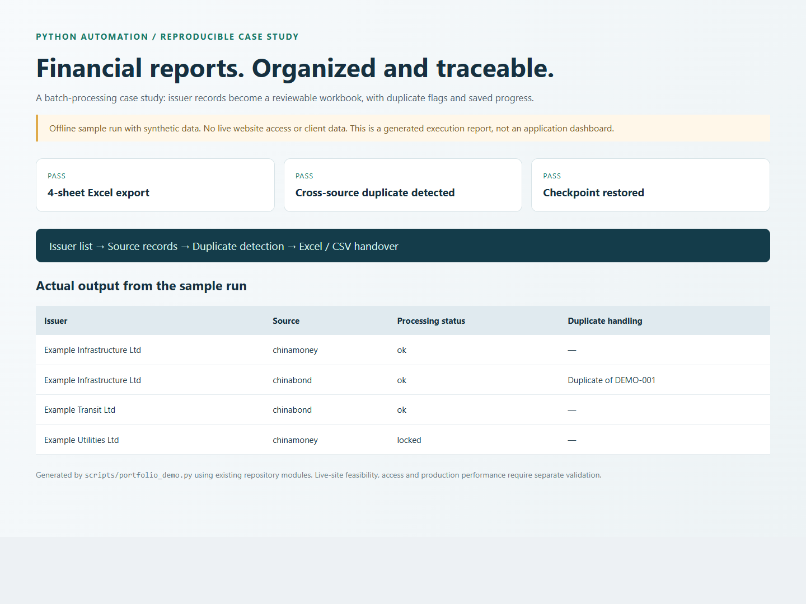

# Financial Report Collection & Excel Delivery

**Turn a list of issuers into an organized collection of credit-rating reports, with a traceable Excel inventory.**

This Python project collects rating disclosures from ChinaMoney and ChinaBond. It demonstrates the complete delivery workflow: issuer input, source-specific requests, PDF downloads, checkpoint recovery, duplicate detection, and business-friendly exports.

## What a client receives

| Input / need | Delivered result |
| --- | --- |
| An issuer name or a CSV/Excel issuer list | Searches across the two supported disclosure sources |
| Reports scattered across websites | PDFs organized by source and issuer |
| Repeated or interrupted collection | Saved issuer/task/page progress and resumable runs |
| Duplicate PDFs | SHA-256 duplicate flags and links to the first matching record |
| A usable handover | Excel workbook, CSV inventories, source links, status and error details |

The repository also includes a Tkinter desktop interface with list import, progress display, pause/resume controls, and Windows executable packaging.

## Live collection verified — 14 October 2026


A bounded run of the original collector queried **ChinaBond for China Three Gorges Corporation**, retrieved **15 report entries**, and downloaded **15 PDF files**. Independent PDF parsing and SHA-256 verification found **10 unique files**, **5 duplicate copies**, and **182 pages across the unique files**. The run used one issuer, the first listing page and one download worker. These are measured sample results, not a claim of full historical coverage or sustained throughput.

Inspect the [15-row manifest with source links, PDF links and hashes](docs/portfolio/live-evidence/manifest.csv), [verification totals](docs/portfolio/live-evidence/verification.json), and [Chinese evidence report](docs/portfolio/live-evidence/report.html). Source PDFs are not redistributed in this repository.

Reproduce the collection with the credential-free [sample configuration](docs/portfolio/live-evidence/settings.json):

```powershell
python main.py --issuer "中国长江三峡集团有限公司" --source chinabond --max-pages 1 --no-proxy --config docs/portfolio/live-evidence/settings.json
```

The same issuer did not yield matching records in the separate ChinaMoney check; the numbers above refer **only to ChinaBond**. Site availability can change.

## Offline portfolio demonstration



The demonstration uses **synthetic records**, runs the existing duplicate-detection and workbook-export modules, and checks checkpoint persistence. It makes no requests to either disclosure website. It is evidence of the local processing path, not a live collection benchmark.

```powershell
python -m venv .venv
.\.venv\Scripts\python.exe -m pip install -r requirements.txt
.\.venv\Scripts\python.exe scripts/portfolio_demo.py
```

Open `docs/portfolio/demo.html` to inspect the generated report. Generated sample exports are stored under `docs/portfolio/sample-output/`.

## Run the collector

Python 3.10+ is recommended. Review `config/settings.json` before a live run, especially request rates, worker counts, output paths and optional proxy settings. Do not publish credentials in configuration files.

```powershell
# Inspect the available options.
python main.py --help

# Start with one issuer, one source and a small listing-only check.
python main.py --issuer "FULL LEGAL ISSUER NAME" --source chinamoney --max-pages 1 --no-download --no-proxy

# Process a limited batch from a spreadsheet.
python main.py --excel issuers.xlsx --start 1 --limit 5 --max-pages 1 --no-proxy

# Open the desktop interface.
python gui_app.py
```

Excel input uses the `issuer_name_clean` column. Resume is enabled by default; `--no-resume` changes that behavior. Source scope can be `chinamoney`, `chinabond`, or `both`.

## Output and implementation

- `downloads/`: downloaded documents grouped by source and issuer.
- `output/评级报告清单.xlsx`: workbook containing source sheets, combined inventory and summary.
- `output/inventory.csv`, `chinamoney.csv`, `chinabond.csv`, `summary.csv`: CSV equivalents; current column labels are Chinese.
- `output/records.jsonl` and `progress.json`: processing records and resumable state.
- `rating_crawler/chinamoney.py` and `chinabond.py`: source adapters.
- `rating_crawler/http.py`: request/download error handling.
- `rating_crawler/inventory.py`: exports and duplicate detection.
- `rating_crawler/progress.py`: checkpoint persistence.

Stack: Python, curl_cffi, pandas, openpyxl and Tkinter. Windows packaging is available through `scripts/build_exe.ps1`.

## Scope and limitations

This implementation targets two specific sources; adapting it to another site is a separate task. Source changes, access restrictions and network conditions can affect collection. Protected documents are recorded as unavailable rather than represented as downloaded. No fixed throughput, historical coverage or unattended uptime is claimed here. The current desktop UI and business exports are primarily Chinese; English localization can be scoped separately.

For a similar project, define the source URLs, required fields, volume, refresh frequency, access permissions and preferred output format first. A small acceptance sample should precede a full run.

[Original Chinese technical notes](docs/legacy-readme.zh-CN.md) are retained for context; the current code and this README take precedence where older paths or output names differ.
