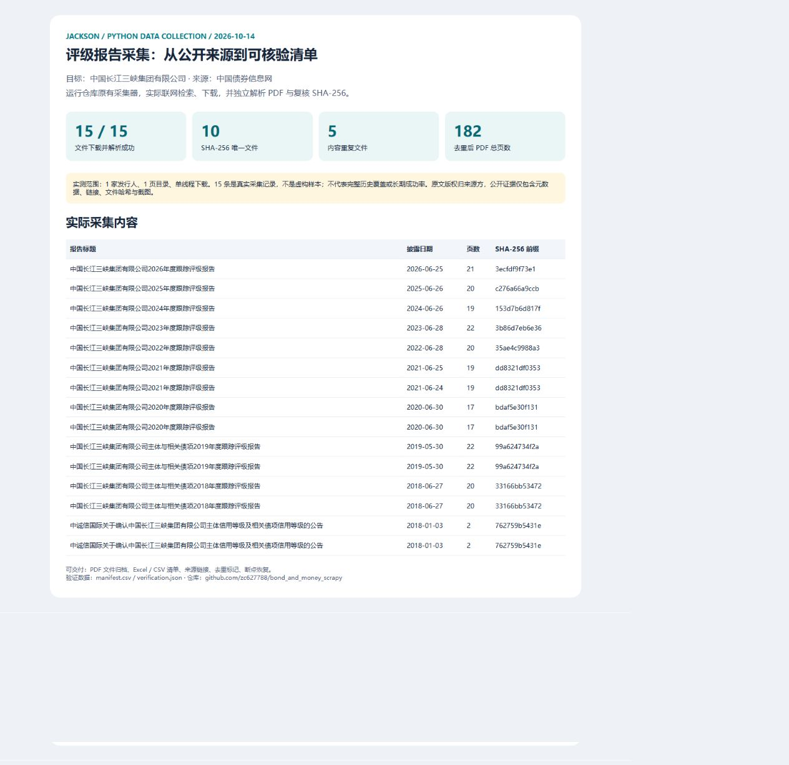

# 评级报告批量下载与 Excel 清单

[English](README.md)

这个工具是用来省掉“逐家公司搜索报告、下载 PDF、再手工登记文件”的重复工作。输入公司名称或企业名单，程序去中国债券信息网、中国货币网查找报告，下载文件，同时整理清单。

我做了命令行入口和 Tkinter 桌面界面，也保留了进度记录、下载状态和重复文件标记。

## 实际下载结果



2026 年 10 月 14 日，用“中国长江三峡集团有限公司”在中国债券信息网跑了一次小范围采集：只取第一页，单线程下载。

- 得到 **15 条报告记录，下载并解析了 15 份 PDF**。
- 按文件哈希比较后，有 **10 份不同的 PDF，5 份重复副本**。
- 10 份不同文件一共 **182 页**。

这里没有把重复文件当成新增成果。清单保留来源地址和文件哈希，后面核对时可以找到对应报告。[查看这次采集的清单](docs/portfolio/live-evidence/manifest.csv)。

中国货币网另做了查询，这个企业没有得到匹配记录，所以没有算进上面的数字。这次只是单个企业第一页的结果，不代表完整历史报告。

## 交付出来是什么

PDF 按来源和企业归档，另有一份 Excel 清单，可以查看来源、下载状态、重复标记和错误信息。也会导出 CSV，方便继续清洗、入库或做报表。

任务进度单独保存，中断后可以接着处理。对于暂时下载不到的文件，清单会留下状态，不会当成下载成功。

## 本地运行

需要 Python 3.10 或以上版本：

```powershell
python -m venv .venv
.\.venv\Scripts\python.exe -m pip install -r requirements.txt
.\.venv\Scripts\python.exe main.py --issuer "中国长江三峡集团有限公司" --source chinabond --max-pages 1 --no-proxy --config docs/portfolio/live-evidence/settings.json
```

桌面入口是 `gui_app.py`；Excel 名单里的企业名称列为 `issuer_name_clean`。批量任务、文件结构和离线示例见 [英文说明](README.md)。

类似需求可以先发一小份企业名单、时间范围和要的表格格式。先把样本核对清楚，再跑整批，会比只约定“抓多少份”更容易验收。
